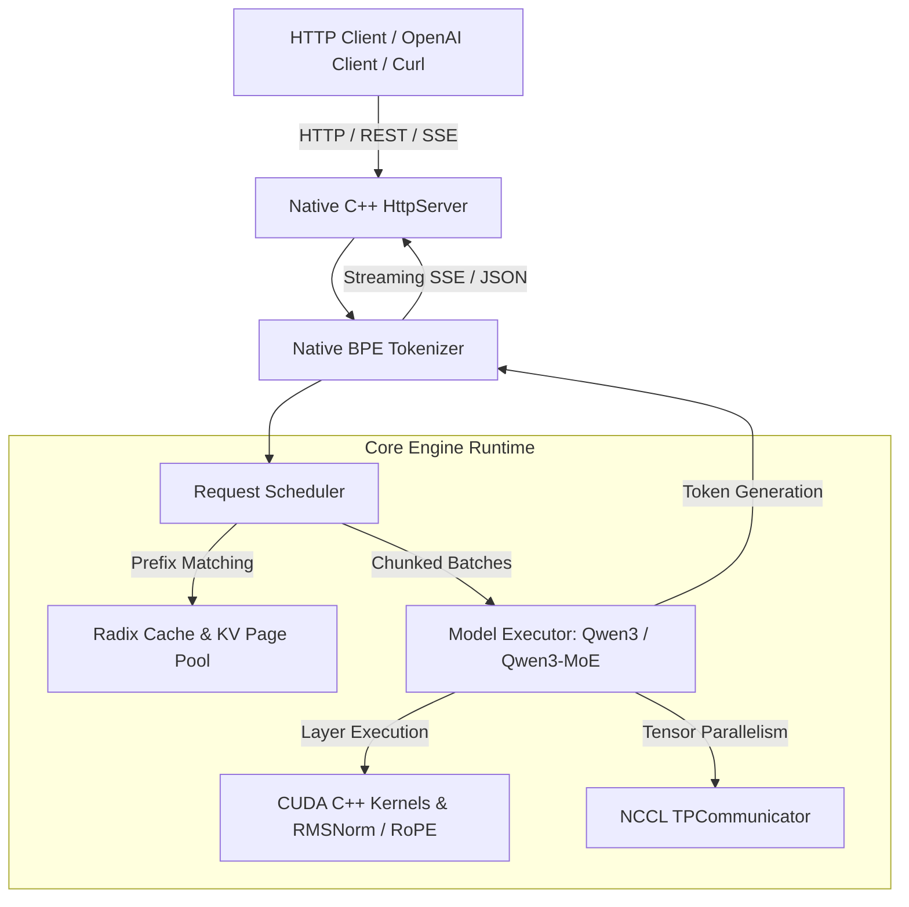

# Mini-SGLang

A lightweight, high-performance native C++/CUDA inference engine for Large Language Models.

---

Mini-SGLang is a standalone native C++/CUDA LLM serving framework designed for low latency, high throughput, and memory efficiency. Built with C++20 and custom CUDA C++ kernels, it provides a complete LLM inference runtime with zero Python dependencies.



## Key Features

- High Performance: Native C++ runtime with custom CUDA C++ kernels for high GPU utilization and minimal CPU overhead.
- Zero Python Dependencies: Entire runtime, tokenizer, model execution, KV cache, scheduler, and HTTP server are written in C++ and CUDA.
- Radix Cache: Reuses Key-Value (KV) cache across requests sharing common prefix tokens to eliminate duplicate prefill computation.
- Chunked Prefill: Splits long prompt prefill sequences into configurable chunks to manage peak GPU memory usage and avoid Out-Of-Memory errors.
- Overlap Scheduling: Overlaps CPU host scheduling preparation with GPU kernel execution across CUDA streams.
- Tensor Parallelism: Scales model inference across multiple GPUs using NCCL collective communication.
- Model Support: Native implementations for Qwen3 and Qwen3-MoE model architectures.

## Quick Start

### One-Line Build Command

To clone, configure, and build Mini-SGLang in Release mode with a single command:

```bash
git clone https://github.com/sgl-project/mini-sglang.git && cd mini-sglang && ./build.sh
```

For CPU-only testing mode without CUDA:

```bash
git clone https://github.com/sgl-project/mini-sglang.git && cd mini-sglang && ./build.sh --cpu
```

### Using the Build Script

Mini-SGLang includes a `./build.sh` script:

```bash
# Build CUDA Release mode (default)
./build.sh

# Build CPU mode (for testing without GPU)
./build.sh --cpu

# Build Debug configuration with 8 parallel jobs
./build.sh --debug -j 8

# Clean build directory before compilation
./build.sh --clean
```

For detailed manual CMake configuration and custom flags, see [docs/build.md](docs/build.md).

### Running the Server

Launch an OpenAI-compatible API server using the native executable:

```bash
# Serve Qwen/Qwen3-0.6B model on default port 1919
./build/minisgl --model Qwen/Qwen3-0.6B --host 0.0.0.0 --port 1919

# Serve with Tensor Parallelism across 4 GPUs
./build/minisgl --model Qwen/Qwen3-0.6B --tp 4 --port 1919
```

Once running, send inference requests using curl or standard OpenAI API clients:

```bash
curl http://localhost:1919/v1/chat/completions \
  -H "Content-Type: application/json" \
  -d '{
    "model": "Qwen/Qwen3-0.6B",
    "messages": [{"role": "user", "content": "Hello"}],
    "max_tokens": 64
  }'
```

### Interactive Shell Mode

Chat directly in the terminal using the interactive shell flag:

```bash
./build/minisgl --model Qwen/Qwen3-0.6B --shell
```

Use `/reset` in the shell to clear conversation history context.

### Running with Docker

Build and run using the multi-stage Docker image:

```bash
# Build Docker image
docker build -t minisgl -f docker/Dockerfile .

# Launch server
docker run --gpus all -p 1919:1919 minisgl --model Qwen/Qwen3-0.6B --host 0.0.0.0
```

## Benchmarks and Testing

Run the test suite using CTest:

```bash
ctest --test-dir build --output-on-failure
```

Run offline throughput benchmark:

```bash
./build/benchmark/bench_offline
```

Run online API latency benchmark:

```bash
./build/benchmark/bench_online
```

## Documentation

- [Build Guide & Options](docs/build.md): Building instructions, CMake options, Docker usage, and dependencies.
- [API Reference](docs/api.md): REST API endpoints, JSON request/response structures, CLI arguments, and interactive commands.
- [System Architecture](docs/structures.md): Architectural design, request lifecycle, Radix Cache, Chunked Prefill, and TP diagrams.
- [Feature Details](docs/features.md): Engine features, memory management, and supported model architectures.
