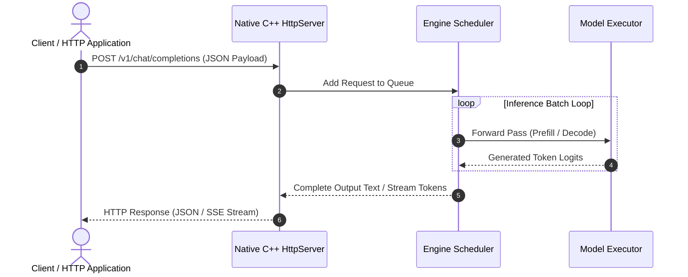

# API Reference Guide

Mini-SGLang provides an OpenAI-compatible HTTP REST server, CLI runtime flags, and an interactive terminal shell interface.

---

## HTTP REST API Endpoints

The HTTP server listens on default port `1919` (configurable via `--port`).



---

### 1. Chat Completions (`POST /v1/chat/completions`)

Accepts standard OpenAI chat completion payloads.

#### Request Headers

```http
Content-Type: application/json
```

#### Request Body Parameters

| Parameter | Type | Default | Description |
| --- | --- | --- | --- |
| `model` | string | **Required** | Model name or HuggingFace repo ID (e.g. `Qwen/Qwen3-0.6B`) |
| `messages` | array | **Required** | List of message objects with `role` (`user`, `system`, `assistant`) and `content` |
| `max_tokens` | integer | `128` | Maximum number of tokens to generate |
| `temperature` | float | `0.7` | Sampling temperature (0.0 for greedy decoding) |
| `top_p` | float | `1.0` | Nucleus sampling probability |
| `stream` | boolean | `false` | Enable Server-Sent Events (SSE) streaming |

#### Example Request

```bash
curl http://localhost:1919/v1/chat/completions \
  -H "Content-Type: application/json" \
  -d '{
    "model": "Qwen/Qwen3-0.6B",
    "messages": [
      {"role": "system", "content": "You are a helpful assistant."},
      {"role": "user", "content": "What is native C++ inference?"}
    ],
    "max_tokens": 128,
    "temperature": 0.7
  }'
```

#### Example Non-Streaming Response

```json
{
  "id": "chatcmpl-minisgl-1",
  "object": "chat.completion",
  "created": 1700000000,
  "model": "Qwen/Qwen3-0.6B",
  "choices": [
    {
      "index": 0,
      "message": {
        "role": "assistant",
        "content": "Native C++ inference refers to running neural network inference directly in compiled C++..."
      },
      "finish_reason": "stop"
    }
  ],
  "usage": {
    "prompt_tokens": 24,
    "completion_tokens": 32,
    "total_tokens": 56
  }
}
```

#### Example Streaming Request

```bash
curl http://localhost:1919/v1/chat/completions \
  -H "Content-Type: application/json" \
  -d '{
    "model": "Qwen/Qwen3-0.6B",
    "messages": [{"role": "user", "content": "Tell me a story"}],
    "stream": true
  }'
```

---

### 2. Text Completions (`POST /v1/completions`)

Accepts raw text prompts for text completion tasks.

#### Request Body Parameters

| Parameter | Type | Default | Description |
| --- | --- | --- | --- |
| `model` | string | **Required** | Model repository ID |
| `prompt` | string | **Required** | Prompt string |
| `max_tokens` | integer | `128` | Maximum generated tokens |
| `temperature` | float | `0.7` | Sampling temperature |

---

### 3. Health Check (`GET /health`)

Returns HTTP 200 OK if the engine server is operational.

#### Request

```bash
curl http://localhost:1919/health
```

#### Response

```json
{
  "status": "ok"
}
```

---

## Command Line Interface (CLI) Arguments

Executable binary options for `./build/minisgl`:

| Argument | Type | Default | Description |
| --- | --- | --- | --- |
| `--model` | string | Required | Path or Hugging Face model ID (e.g. `Qwen/Qwen3-0.6B`) |
| `--host` | string | `0.0.0.0` | Host IP address to bind HTTP server |
| `--port` | integer | `1919` | Network port for HTTP API server |
| `--tp` | integer | `1` | Tensor Parallelism degree (number of GPUs) |
| `--max-prefill-length` | integer | `16384` | Maximum prefill sequence length for chunked prefill |
| `--max-batch-size` | integer | `32` | Maximum concurrent batch size for decode |
| `--cache` | string | `radix` | Cache strategy: `radix` or `naive` |
| `--shell` | flag | `false` | Launch interactive CLI terminal mode instead of HTTP server |

---

## Interactive Terminal Shell Mode

Launch terminal conversation mode with:

```bash
./build/minisgl --model Qwen/Qwen3-0.6B --shell
```

### Interactive Commands

- `/reset`: Reset conversation context and clear prompt history.
- `/exit` or `Ctrl+C`: Exit interactive terminal shell.
