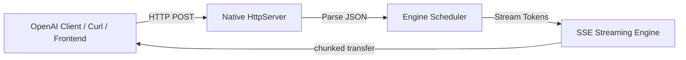
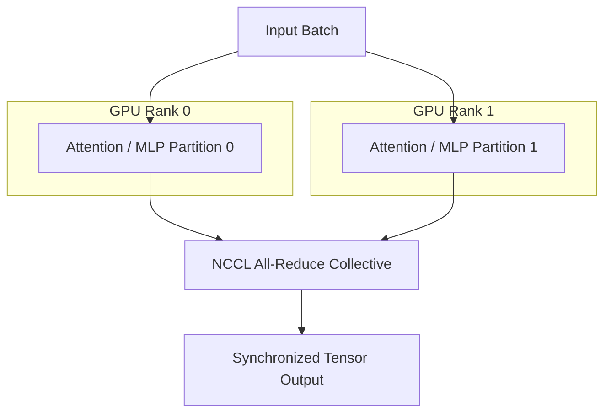
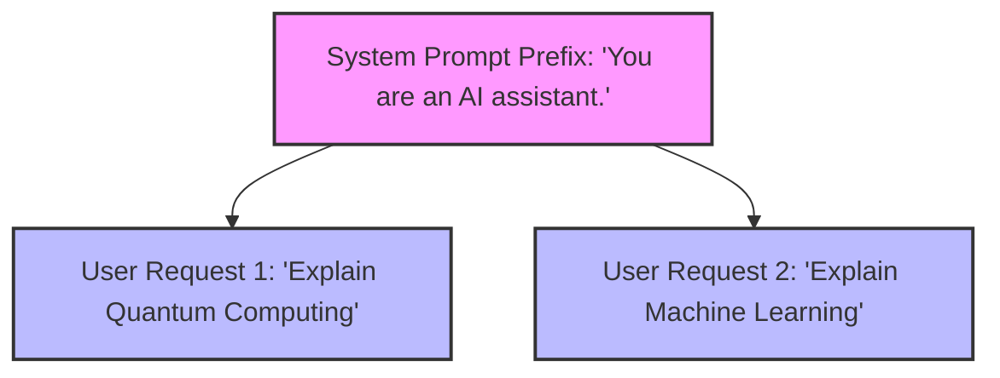

# Features of Mini-SGLang Native Engine

Mini-SGLang provides a comprehensive set of serving features engineered for low latency, memory efficiency, and scale.

---

## 1. Online Serving Engine

Mini-SGLang provides an OpenAI-compatible HTTP API server written natively in C++.



- **OpenAI Compatibility**: Supports `/v1/chat/completions` and `/v1/completions`.
- **SSE Streaming**: Low-latency, token-by-token streaming responses via Server-Sent Events (`stream: true`).
- **Health Verification**: `/health` endpoint for readiness/liveness checks.

---

## 2. Interactive Terminal Shell Mode

An interactive terminal shell is available for prompt testing and direct conversation without needing HTTP clients.

```bash
./build/minisgl --model Qwen/Qwen3-0.6B --shell
```

- Features conversation context tracking across turns.
- Includes `/reset` command to instantly clear context history.

---

## 3. Multi-GPU Tensor Parallelism (TP)

Tensor Parallelism scales model weights and attention computation across multiple NVIDIA GPUs using native NCCL collective communications (`ncclAllReduce`, `ncclAllGather`).



- Scalable execution using `--tp N`.
- Async GPU communication streams overlapped with computation.

---

## 4. Supported Model Architectures

Mini-SGLang natively supports state-of-the-art transformer architectures:

1. **Qwen3 Dense Models**:
   - Rotary Position Embeddings (RoPE).
   - RMSNorm pre-normalization.
   - SwiGLU feed-forward networks.
2. **Qwen3-MoE Mixture-of-Experts**:
   - Dynamic top-k expert routing.
   - Shared expert layers and specialized routing CUDA kernels.

---

## 5. Chunked Prefill Memory Management

Chunked prefill prevents GPU out-of-memory errors on long input sequences by splitting prompt tokens into fixed-size chunks.

```mermaid
gantt
    title Chunked Prefill vs Continuous Decode Execution
    dateFormat X
    axisFormat %s
    section Prefill Chunk 1
    Process 1024 Tokens :active, p1, 0, 10
    section Decode Batch 1
    Batch Decode Step 1 :crit, d1, 10, 12
    section Prefill Chunk 2
    Process 1024 Tokens :active, p2, 12, 22
    section Decode Batch 2
    Batch Decode Step 2 :crit, d2, 22, 24
```



- Interleaves prefill chunks with decode batches to preserve overall generation throughput.
- Configurable via `--max-prefill-length N`.

---

## 6. Radix Cache Token Reuse

Radix Cache indexes KV cache pages using a Radix tree structure based on input token prefixes.



- Matches incoming token sequences against existing cached prefixes.
- Eliminates redundant attention key-value calculations for common prompt prefixes.
