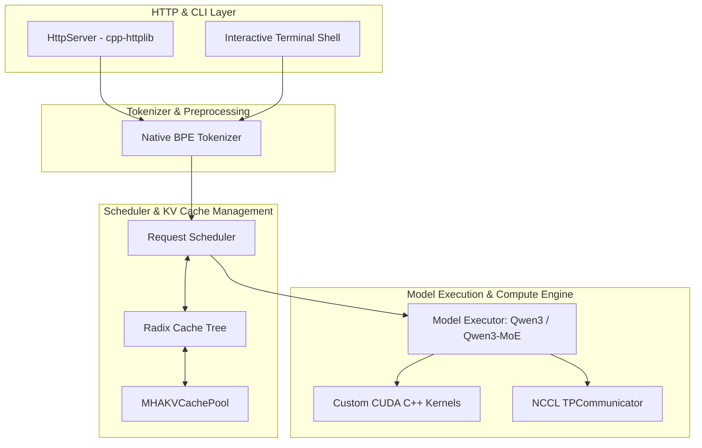
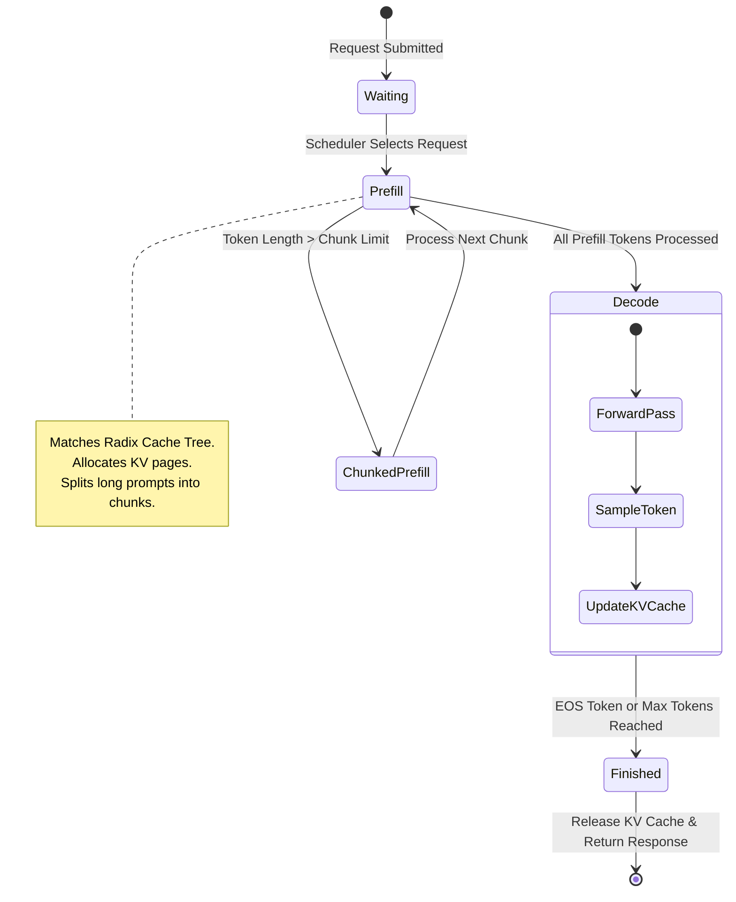
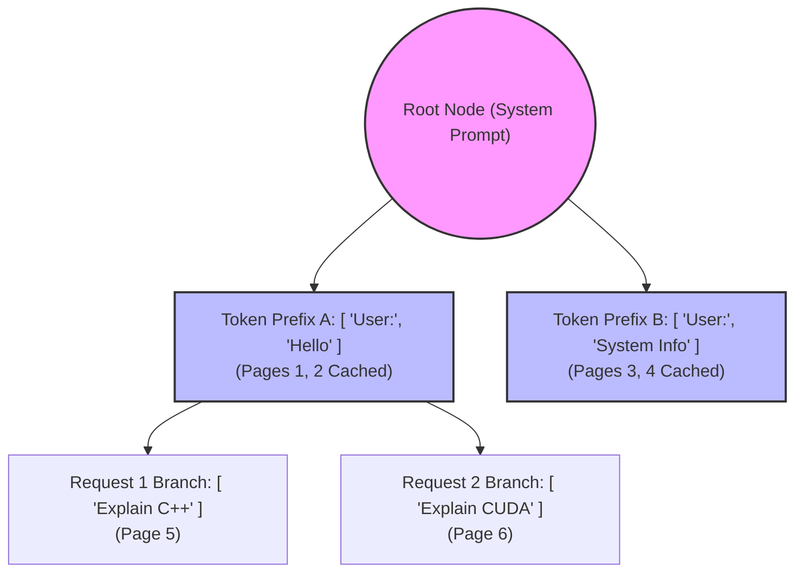
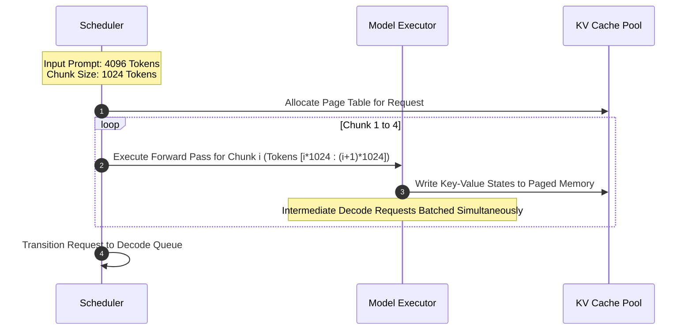
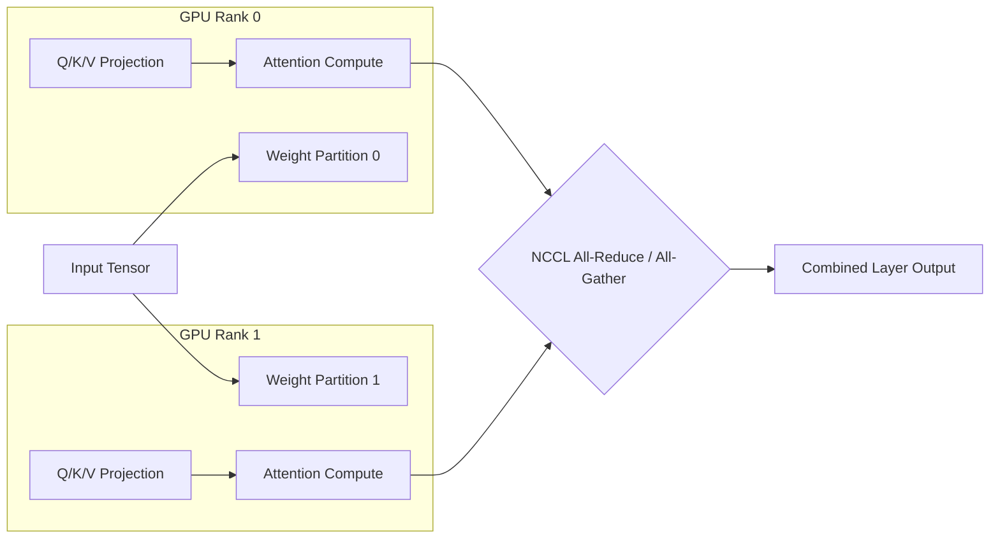

# System Architecture of Mini-SGLang Native Engine

## Architecture Overview

Mini-SGLang is constructed as a native C++/CUDA inference system composed of C++ runtime components:

### Component Breakdown

1. **HttpServer**: Native C++ REST server (`cpp-httplib` and `nlohmann/json`) exposing OpenAI-compatible endpoints (`/v1/chat/completions`, `/v1/completions`, `/health`) and SSE streaming responses.
2. **Tokenizer**: Native C++ BPE tokenizer parsing Hugging Face `tokenizer.json` and `tokenizer_config.json`, applying Qwen chat templates, and performing incremental detokenization.
3. **Scheduler**: Manages request lifecycle (waiting queue -> prefill -> decode -> completion), page allocation in the KV cache, Radix Cache prefix matching, and chunked prefill chunking.
4. **Model Executor**: Native C++ model implementations for Qwen3 and Qwen3-MoE (`Qwen3ForCausalLM`, `Qwen3MoEForCausalLM`) with layer-by-layer forward execution.
5. **CUDA Kernels**: Custom CUDA C++ kernels for RMSNorm, Rotary Position Embeddings (RoPE), Index Gathering, and KV Page Store.
6. **TPCommunicator**: Native NCCL communicator performing tensor-parallel all-reduce and all-gather operations across GPU ranks.

---

## Detailed Systems Workflows & Diagrams

### 1. Request Lifecycle & Scheduler State Machine

---

### 2. Radix Cache Page Reuse Engine

The Radix Cache maintains a tree structure of prefix token sequences. When a new request arrives, the scheduler traverses the Radix Cache tree to find the longest matching cached token prefix.

When Request 2 arrives sharing `[ 'User:', 'Hello' ]`, pages 1 and 2 are reused instantly, avoiding redundant KV computation.

---

### 3. Chunked Prefill Execution Pipeline

Chunked prefill prevents peak GPU memory spikes caused by long input prompts by partitioning the prefill stage into fixed-size chunks (`--max-prefill-length`).

---

### 4. Distributed Tensor Parallelism (NCCL) Architecture

Tensor Parallelism distributes linear projections across multiple GPU devices using NCCL collectives.

---

## Directory Structure

- `include/minisgl/core`: Tensor memory abstractions, data types, requests, batching, and context.
- `include/minisgl/model`: Model configurations (`ModelConfig`), Safetensors `WeightLoader`, Qwen3 and Qwen3-MoE model headers.
- `include/minisgl/layer`: Neural network layers (Embedding, RMSNorm, Linear, RotaryEmbedding, SwiGLU, MoERouter).
- `include/minisgl/cache`: Paged KV cache allocation (`MHAKVCachePool`), Radix Cache, and Naive Cache.
- `include/minisgl/scheduler`: Request scheduler and batching engine.
- `include/minisgl/distributed`: Tensor Parallelism communicator (`TPCommunicator`).
- `include/minisgl/tokenizer`: Native Tokenizer and Detokenizer.
- `include/minisgl/server`: HTTP API Server, CLI argument parser, and Interactive Terminal Shell.
- `kernels/cuda`: Custom CUDA C++ kernels (`rmsnorm.cu`, `rotary.cu`, `index.cu`, `radix.cu`).
- `src/`: Native C++ source implementations.
- `tests/`: CTest unit, CUDA, and integration test suites.
- `benchmark/`: Benchmark executables (`bench_offline`, `bench_online`).
- `docker/`: C++ multi-stage Dockerfile.
